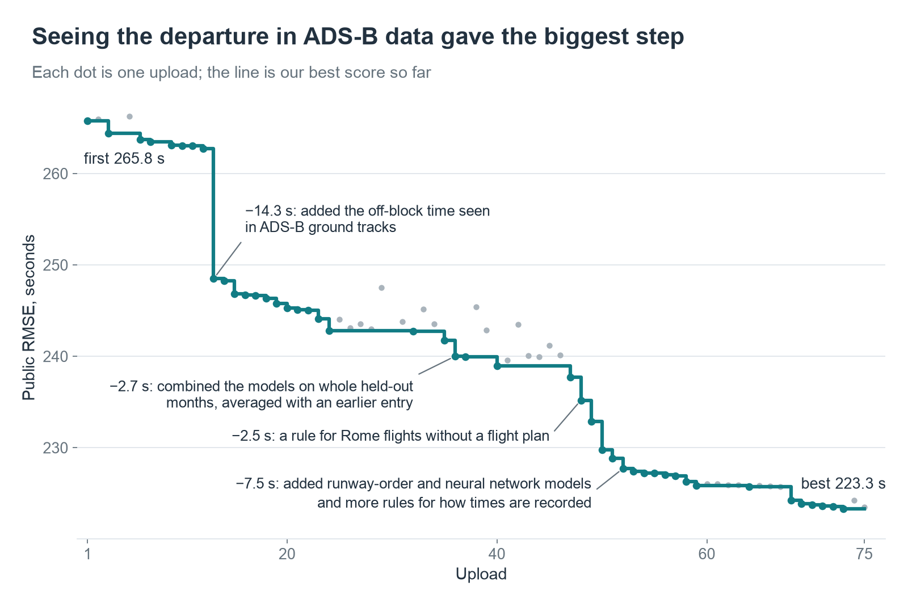
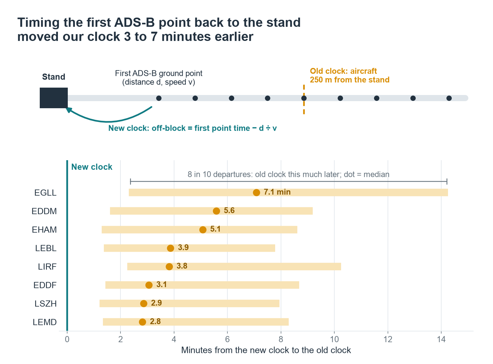
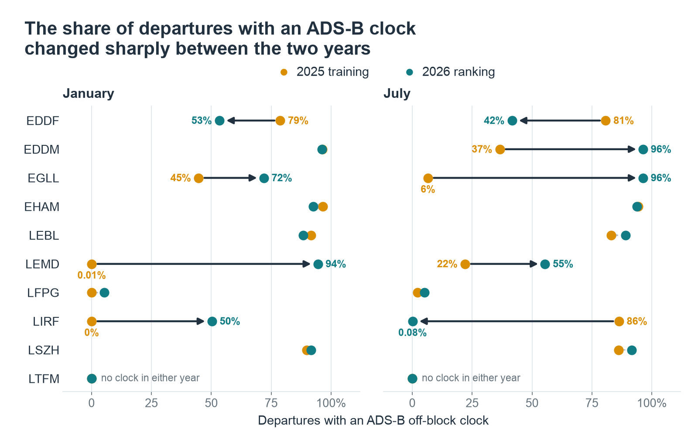
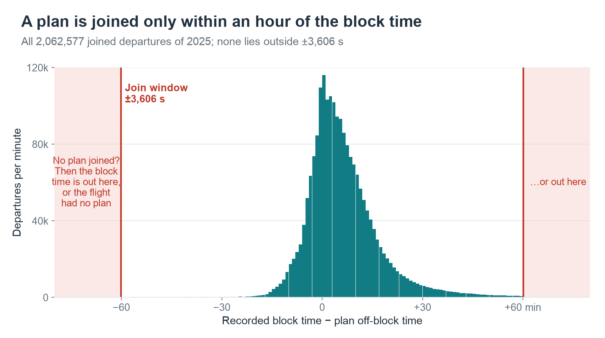
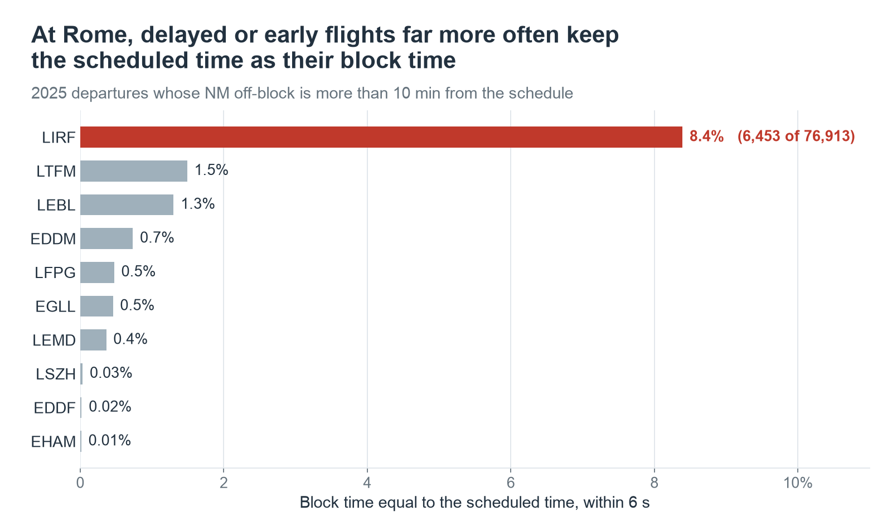
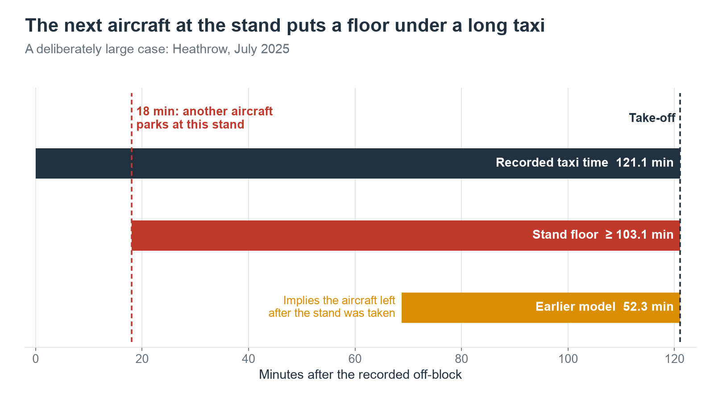
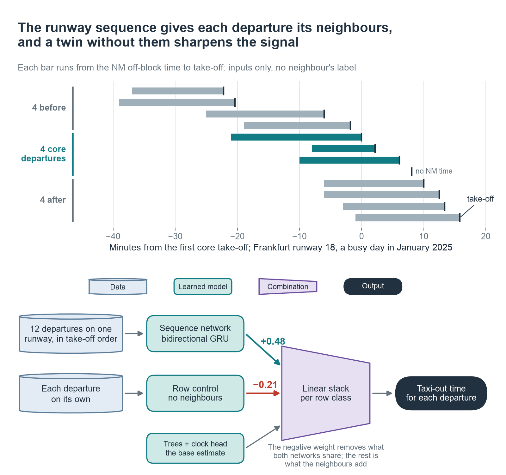
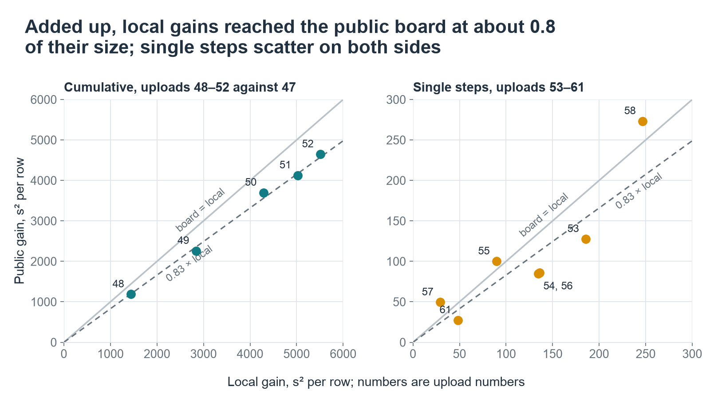
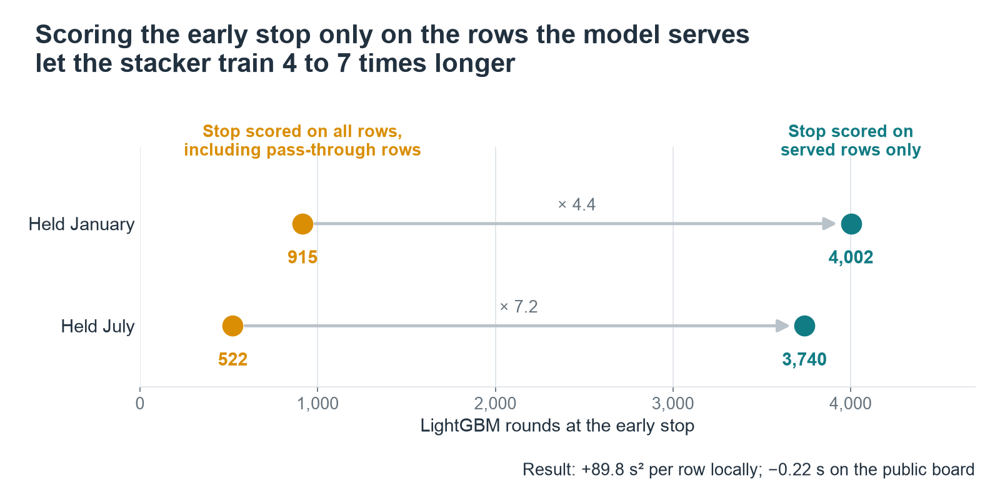
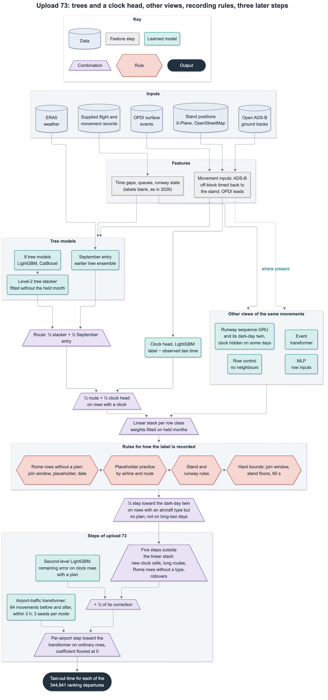

# Reconstructing taxi-out times at ten European airports

Team **youthful-giraffe** · PRC Data Challenge 2026

<!-- FREEZE UPDATE: keep the current entry, score, rank and final candidate here. -->
> **Snapshot, 8 October 2026.** Final entry: **upload 73, 223.3071 s RMSE**, **10th of 237 teams**
> on the 06:52 UTC board. Our first entry scored 265.7612 s, so we are **42.45 s** better.
> We stopped work on 8 October and keep upload 73 for the model freeze on **8 October 2026,
> 12:00 UTC**. This page describes upload 73.
<!-- END FREEZE UPDATE -->

We reconstructed the taxi-out time of 344,841 departures at ten airports. About half of our gain
came from seeing the departure in open ADS-B ground tracks; rules for how the airport records the
label, models of other kinds and a month-held stack made most of the rest.

Public scores are RMSE in seconds (lower is better). Local gains are reductions in mean squared
error on held-out 2025 months, in s² per row, weighted to the 2026 mix (higher is better).

## The ADS-B ground track shows when the aircraft left

We matched departures to open adsb.lol ground tracks and let a LightGBM head correct the rows
with a clock from what the track shows: one upload, 262.74 to 248.48 s. This first clock started
when the aircraft was 250 m from the stand; timing the first received point back to the surveyed
stand moved it 3 to 7 minutes earlier at the median and gained 0.90 s more.

## Clock coverage moved, so the clock head reads only movement

Rome lost almost all its July clocks (86.3 % to 0.08 % of departures), Heathrow gained them
(6.5 % to 96.4 %), and Madrid went from one January clock row to 94 %. ADS-B reception shifts
between the years, so we rebuilt the clock head on movement inputs only (the clock timed back to
the stand, OPDI surface events, pushback phases) and dropped the inputs that describe reception.
It gained 2.38 s against its parent entry. Local scores are weighted to the 2026 mix of airport,
month and row class; cells new in 2026 remain extrapolations.

## The plan join bounds the missing block time

In all 2,062,577 joined departures of 2025, the recorded block time lies within 3,606 s of the
plan off-block time. With a plan, that brackets the label. Without one, it says where the block
time is not: when the flight's arrival elsewhere still carries the plan times, we can tell a real
late block time from a schedule placeholder, and a date check finds rollovers. This treatment of
Rome rows without a plan or aircraft type, with its own placeholder and rollover branches, covers
383 ranking rows and took the public score from 237.71 to 235.20 s.

## At Rome, the block time is often the schedule

Among 2025 departures whose NM off-block is more than 10 minutes from the schedule, 8.4 % of
Rome block times equal the scheduled time within 6 s; no other airport exceeds 1.5 %. The unit
is the airline: in ten airlines, 1,689 of 1,699 late departures in 2025 carry the placeholder.
For these airlines we move the prediction to take-off minus schedule once their arrival records
confirm the practice: +43 s² per row locally, and +233 for the same practice on single routes of
other airlines. We set both rules after tables of all 2025 months, the held months included, so
these local reads include that choice.

## The next aircraft at the stand bounds a long taxi

When another aircraft parks at the stand, the departing one had already left, so take-off minus
that in-block time bounds the taxi time from below (we require different aircraft types and a
timing that fits the plan). It moved 27 ranking rows and gained 844 s² per row locally, most of
it from one Heathrow case; without that case, 242. We chose its airports and limits on the same
held months.

## Neighbours on the runway are a different view

Extra tree learners stopped helping once their errors matched the trees we had. A bidirectional
GRU over one runway's departures in take-off order (four core rows, four on each side, no
neighbour labels) added what the trees missed. Its twin without neighbours enters the linear
stack with a negative weight, so the stack keeps what the neighbours add. The first pair gained
1,230 s² per row, an optimistic read of one seed with a form that we chose on the same months; an
event-sequence transformer and an MLP add two more views.

## Validate on whole months

Our first validation held out weeks inside a month, and the second-stage stacker learned
airport-month patterns from the other weeks: +3,130 s² per row locally, 0.78 s worse on the board.
Holding out January and July 2025 whole at every fitted stage but one (our September entry) fixed
it: the month-held stacker gained 1.01 s, and a half blend with that entry 1.73 s more. On the
later stack entries, the board kept 0.80 to 0.86 (about 0.83) of our recorded local gain, added up
from upload 47 to 52; single steps scatter from 0.57 to 1.69. On the raw held-month gain the ratio
is 0.73, and 0.96 without the five largest 2025 airport-days, which the 2026 weights enlarge; we
made that split after the first read. Most of these local gains include choices that we made on the
same held months. One step after upload 59, a time-input fix with a positive local read, lost 0.23
s. From upload 68 to 73 the board kept 1.03 of the held gain. No value in the scored model came
from a board score.

## Stop early on the rows you serve

The stacker's early stop also scored rows that it passes through unchanged. Scoring only the
rows it serves let it train 4 to 7 times longer: +89.8 s² per row locally and 0.22 s on the
board. This route was one of several variants read on the same held months.

## The model behind upload 64

Eight tree models feed a month-held stacker, half-blended with our September entry; on rows with
a clock, a clock head takes half. A linear stack per row class adds the other views. Recording
rules follow, then one projection onto all hard bounds with a 60 s floor. Uploads 58 and 59
added the last record rules with that projection (−0.60 s) and a stacker refitted once on its
nine training months (−0.47 s).

Upload 62 added three parts to upload 59: a 12-fit bag of the transformer, a twin of the runway
model trained with the clock hidden on some airport-days (the dark-day twin), and the time-input
fix. It also dropped a rule that read the file order: 225.91 s, 0.06 s behind upload 59. Upload 64
adds one more step. About 4,900 departures of 2026 have an aircraft type but no flight-plan match,
so the linear stack does not reach them. We move each of them a quarter of the way toward the
dark-day twin, inside the same bounds, except on 15 airport-days on which many departures took an
hour or more to take off in the network records, such as the Amsterdam snow days of January. The
step fits nothing. We chose these rows and this model after one look at a wider test; two other
models gain on the same rows. It gained +97 s² per row locally and 0.20 s on the board against
upload 62.

## The last steps: upload 73

After upload 64, two more agents built three groups of steps from our v64 release files, the
official data and the files of the agent before them, without our development repository:

- **Five steps on rows outside the linear stack (upload 68).** Madrid, Paris and Rome clock rows of
  January 2026 have no 2025 rows of their kind; they now get stacks of the member models, fitted on
  other cells. Long-route rows get half a step toward a member stack. Some Rome rows without an
  aircraft type move a small step toward 900 s, a typical real taxi time. Three such rows took off
  15 to 17 hours after their schedule; they get the expected value of the two possible recorded
  times, with the share of each from a fit on 2025 rows of the same kind. The held read is +1,990
  s² per row, and six held Rome rows carry most of it; they are also among the 2025 rows that
  showed the rollover practice, which we looked at when we chose the step. Without the rollover
  step the read is +149. The board went from 225.71 to 224.24 s.
- **A second-level model on clock rows (upload 69).** A LightGBM model learns the remaining error
  on rows with a clock and a flight-plan match, from the member values and row inputs, and we add
  half of its correction: +113 s² per row on the held months, and 224.24 to 223.86 s on the board.
- **A transformer over the airport's traffic (uploads 70 to 73).** It reads the 64 movements
  before and after the departure at the same airport within 3 hours: arrivals with their taxi-in
  times, departures with their network times. On ordinary rows, its difference from the entry
  enters with one coefficient per airport, with no negative coefficients. Four uploads made the
  window wider and added seeds: +295 s² per row on the held months over upload 69, and 223.86 to
  223.31 s on the board, 0.83 of the held gain.

We chose the form of the last two steps on the same held months that score them: the L2C factor
0.5, its tree settings and its clock-row scope; for the transformer step, the rows it skips, the
floor at zero, one coefficient per airport, half the coefficient on Rome July rows, the members,
the window width and the number of seeds. Two later uploads scored worse than upload 73. Upload 74,
from a third agent, added five steps that gained mostly on Rome rows without an aircraft type:
+1,045 s² per row on the held months over its parent, the one-seed form of upload 73, and 0.94 s
worse than upload 73 on the board. Its agent chose the bounds of the Rome calibration regions after
a look at the held table of both months. Upload 75 gave the last step a second column: +86 s² per
row on the held months, 0.21 s worse on the board. We chose that form among four forms read on the
same held months.

## What did not help

Weather did not help beyond the older entry. ERA5 inputs in an early learner helped January and
hurt July, as the actual times already carry most of what weather explains; hourly METAR does
not hold the runway-hour state; and weather lost in the clock head. Wider queue windows added noise; the signal sits next to the
departure. More learners on the same inputs got zero weight because their errors matched the
stack's, and a sequence model on tree residuals had seeds that shared most of their error.

At Rome, a separate model owed its July gain to one date-rollover row and lost in other months,
and a per-flight placeholder forecast lost because the placeholder follows the airline, not the
traffic. Pseudo-labels for rows without a clock lowered Rome's placeholder and long rows.
Reweighting held rows toward 2026 collapsed the effective sample.

## Reproduction and detail

The reproduction rebuilds the file of upload 73 (SHA-256 `70236754…`, 223.3071 s): first the
file of upload 64, then the steps of upload 73. It refits the step models from the 2025 labels
and reads saved values of the transformer, whose GPU fits do not repeat bit for bit. The bytes
match on x86-64 Linux; on macOS the trees of the second-level model come out different.

[Technical reference](METHOD.md) · [reproduction](METHOD.md#7-how-to-reproduce) ·
[figure script](figures/src/build_figures.py) · [record extract](figures/src/evidence.json) ·
[source of every number](CLAIMS-SOLUTION.md) · [data sources and notices](METHOD.md#22-open-external-data)

## How we worked

AI coding agents built on Claude and GPT models wrote most of the code and ran most of the
analysis; the human team member set the direction and chose which kinds of work to pursue. From
upload 6 on, a fresh-context model reviewed each upload, and from upload 34 on we froze a board
forecast before each one. Uploads 68 to 75 came from agents that had our v64 release files, the
official data and the files of the agents before them, without our development repository.

Thanks to EUROCONTROL PRC for the challenge and the data, and to adsb.lol, OurAirports, the
X-Plane Scenery Gateway, OpenStreetMap, Copernicus and OPDI for the open observations.
